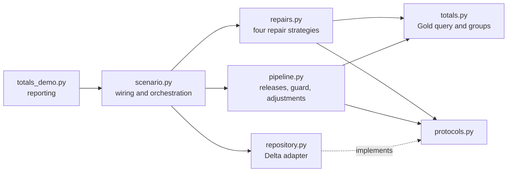

# Silver to Gold Totals

**Find and repair the Gold totals that one Silver change affects, checked against a full rebuild, with an executable local Delta Lake example.**

Companion code for **One Silver Row Changed. Which Gold Totals Must Change?** An order moves to another day and region. The new day's total goes up, and the old day's total stays where it was, so the report counts the order twice. The project shows why the old group is the one a repair forgets, compares four ways of repairing Gold, and shows how an older repair can overwrite a newer one.

Silver holds the latest state of each order; Gold holds daily totals derived from it. The **grain** of a table is what one row stands for: here, one Gold row is one business date and one region. A **change data feed (CDF)** records each Silver update as two rows: a **pre-image** with the old values and a **post-image** with the new ones.

The example uses synthetic order data, Python, pandas, and the open-source `deltalake` library (delta-rs). It runs locally without Spark or a Databricks workspace.

## Choose a repair

| Repair | Appropriate when | Local implementation |
| --- | --- | --- |
| **Materialized view** | Gold's totals are current truth and the engine can keep the query up to date. | Not run. It is a Databricks feature; the article describes its incremental refresh. |
| **Replace old and new groups** | Gold must be a table you write. | [`ReplaceAffectedGroups`](src/repairs.py) takes the groups named by the pre-image and the post-image, recomputes them in full, and replaces exactly those groups in one commit. |
| **Refuse stale releases** | Repairs can overlap or be retried. | [`publish(guard=True)`](src/pipeline.py) records the Silver version each release read and refuses a release older than the last one. |
| **Adjust closed periods** | A month is approved and must stay fixed. | [`adjustments`](src/pipeline.py) books the difference in a later month instead of restating the closed one. |

Three more repairs are deliberate counterexamples: [`NewGroupsUpsert`](src/repairs.py) misses the old group, [`OldAndNewUpsert`](src/repairs.py) cannot remove a group that became empty, and [`ChangedRowArithmetic`](src/repairs.py) gets distinct counts wrong.

**Implementation scope:** Silver and every Gold variant are real Delta tables on local disk. Group replacement uses the `deltalake` library's predicate overwrite, which plays the role of Databricks `REPLACE WHERE`; upserts use its `merge`. The race between two repairs is a sequential replay of their releases, not a concurrent run. The closed-month example computes month totals in memory and does not persist an adjustments table. No Databricks materialized view, `REPLACE WHERE`, or `MERGE` is executed.

## Quick start

Requirements: **Python 3.10+**, `pip`, and Bash for the helper script. The first setup requires access to the Python package index. `make` is optional.

Run from the repository root:

```bash
./run_demo.sh
```

The script creates `.venv` if needed, installs `requirements.txt`, runs the tests, and prints the scenario results. `deltalake` is pinned to `1.6.6`; the other dependencies have minimum versions.

The demo deletes and recreates the repository's `lake/` directory on each run. Keep that directory reserved for generated demo data. The Python helper `run(lake)` likewise removes the directory passed to it.

To run the same steps manually:

```bash
python3 -m venv .venv
.venv/bin/python -m pip install -r requirements.txt
.venv/bin/python -m pytest
.venv/bin/python -m src.totals_demo
```

### Development commands

| Command | Action |
| --- | --- |
| `make` | Run lint, formatting checks, type checks, tests, and the demo. |
| `make setup` | Create `.venv` and install runtime and development tools. |
| `make test` | Run `pytest`. |
| `make lint` | Run `ruff check` and `ruff format --check`. |
| `make types` | Run `mypy src`. |
| `make demo` | Print the demo results. |
| `make clean` | Remove `.venv`, `lake/`, tool caches, and Python bytecode caches. |

The check and demo targets run dependency setup first. Once dependencies are installed, invoke tools directly with `.venv/bin/python -m pytest`, `.venv/bin/python -m ruff check .`, `.venv/bin/python -m ruff format --check .`, or `.venv/bin/python -m mypy src`.

## What the example demonstrates

Silver starts with eight accepted orders, and Gold has five daily totals. Order **7** (customer C, amount 25) moves from **3 Nov West** to **4 Nov East**. Customer C still has order 4 in 3 Nov West. Order **8**, the only order in **5 Nov South**, is then cancelled. Each value below is (amount, orders, distinct customers).

| Step | Expected result |
| --- | --- |
| Read the CDF for order 7's move | The pre-image names 3 Nov West and the post-image names 4 Nov East. New rows alone name only 4 Nov East. |
| Recompute only the groups the new rows name, then upsert | 3 Nov West keeps **(125, 3, 2)**; a full rebuild says **(100, 2, 2)**. 5 Nov South keeps 90. |
| Recompute old and new groups, then upsert | 3 Nov West is right, but the upsert cannot remove 5 Nov South, which now has no orders. |
| Recompute old and new groups, then replace them | Gold matches the full rebuild. The empty group disappears. |
| Add and subtract the changed rows | Amount and order count are right, but 3 Nov West has **1** distinct customer instead of **2**, and 5 Nov South is left as a row of zeros. |
| Release a repair built from Silver version 3, then retry one built from version 1 | Without the guard, 3 Nov West goes back from **95** to **100**. With the guard, the older release is refused. |
| Close October at 150, then correct an October order by −5 in November | Dropping the late row leaves the report at **370** while Silver says **365**. Booking a November adjustment keeps October at 150 and the report at 365. |

The executable prints all outcomes. [`test_article_claims.py`](tests/test_article_claims.py) checks the reported values against real temporary Delta tables.

## Example output

The following successful `./run_demo.sh` run passed all **13 tests** and printed the results below. Test timing varies by machine; package installation and update notices are omitted.

```text
$ ./run_demo.sh
{out}
```

## Data and change semantics

Each Silver order has six fields:

| Field | Meaning |
| --- | --- |
| `order_id` | Integer order identifier. |
| `business_date` | Business date, as an ISO `YYYY-MM-DD` string. Part of the Gold grain. |
| `region` | Region name. Part of the Gold grain. |
| `customer` | Customer code, used for the distinct-customer count. |
| `amount` | Whole-number amount in one currency. |
| `status` | `accepted` or `cancelled`. Gold counts accepted orders only. |

Gold is the query in [`full_rebuild`](src/totals.py): for accepted orders, `SUM(amount)`, `COUNT(*)`, and `COUNT(DISTINCT customer)` by `business_date` and `region`. Every repair that recomputes groups uses this same query, so it stays the one definition of a total.

Each Silver change is one `UPDATE` commit. The reader returns CDF rows ordered by commit, order, and change type, with pre-images before post-images. The **work set** is every group named by a pre-image or a post-image, so a cancelled order still adds the group it leaves.

[`GoldTotals.replace_groups`](src/repository.py) overwrites the rows matching the work set and writes the Silver version it read into the commit's metadata. A group the query no longer returns is not written back, which is how an empty group disappears. Whether an empty group should vanish or show zero is a reporting decision.

See [`data/README.md`](data/README.md) for the seed fields and timeline.

## Architecture and SOLID assessment



The code broadly follows SOLID at the scale of a teaching project, with specific gaps:

| Principle | Assessment |
| --- | --- |
| **Single responsibility** | The Gold query, repair strategies, release logic, persistence, orchestration, and reporting are separated into focused modules. |
| **Open/closed** | A new repair is a new class with `name` and `apply`; the comparison loop runs it against a full rebuild without changes. |
| **Liskov substitution** | The four repairs share the `GoldRepair` contract and run in the same loop. Sharing the interface does not make them equivalent: three are counterexamples by design. There is no in-memory `OrderTable` or `TotalsTable` fake, so substitution of the storage adapters is not tested. |
| **Interface segregation** | `OrderTable` only reads Silver, `GoldRepair` has one method. `TotalsTable` bundles upsert, group replacement, and the stale-release check, which not every repair needs. |
| **Dependency inversion** | `repairs.py` and `pipeline.py` depend on protocols and never import `deltalake`. `scenario.py` also calls adapter-only methods directly (Silver updates and Gold table creation). The adapter imports the domain's `tidy` helper. |

The current structure is useful for the example. Before broadening it, add in-memory fakes with shared adapter tests, split the stale-release check from the write interface, and build predicates from structured values instead of string formatting.

## Repository layout

```text
.
├── data/
│   ├── orders.json          # Eight synthetic orders and the changes applied to them
│   └── README.md            # Seed fields and timeline
├── src/
│   ├── models.py            # Gold grain, columns, OrderChange, Release, Adjustment
│   ├── protocols.py         # OrderTable, TotalsTable, and GoldRepair interfaces
│   ├── totals.py            # The Gold query, affected groups, and comparisons (pure pandas)
│   ├── repairs.py           # Four repair strategies
│   ├── pipeline.py          # Releases with the stale guard; closed-month adjustments
│   ├── repository.py        # Silver orders and Gold totals as local Delta tables
│   ├── scenario.py          # Example orchestration and structured results
│   └── totals_demo.py       # Composition root and printed report
├── tests/
│   ├── conftest.py               # Temporary Delta scenario fixture
│   ├── test_article_claims.py    # End-to-end checks of the example results
│   └── test_totals.py            # Gold query, groups, and adjustments without storage
├── Makefile
├── pyproject.toml
├── requirements.txt
└── run_demo.sh
```

## Scope and limitations

- **Local demonstration:** all reads are materialized in pandas. Eight synthetic orders illustrate correctness, not throughput or cost.
- **The guard is not atomic:** `publish` reads the last released version and then writes, in two steps. Two writers can both pass the check. A real guard needs the check inside the commit, for example a conditional write or a single writer per Gold table.
- **Sequential race:** the two releases are applied one after the other to replay the interleaving. No concurrency is exercised.
- **String predicates:** group predicates and update values are formatted into SQL strings without escaping. They are safe only for the controlled values in this example.
- **Joins are not covered:** the work set comes from the orders table's change feed. A reference-table change, such as a store moving region, can change many groups with no order row changing.
- **Closed months in memory:** approved totals and adjustments are computed in the scenario, not stored. A real report needs the approved totals and the adjustment rows persisted and owned.
- **Engine scope:** the change shapes come from local delta-rs writes. They do not establish how a Databricks materialized view, `REPLACE WHERE`, or `MERGE` behaves.

## Data and license

All example data is synthetic. No `LICENSE` file is included, and the repository does not currently declare a reuse license.
