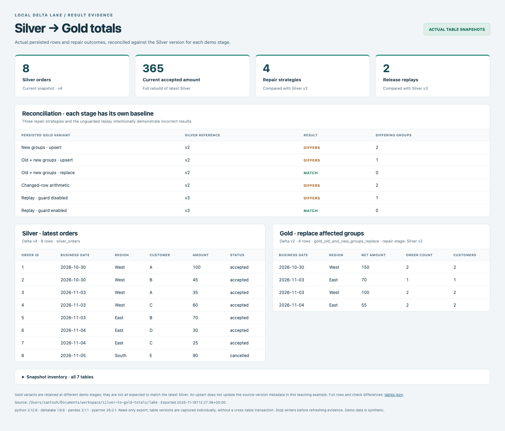
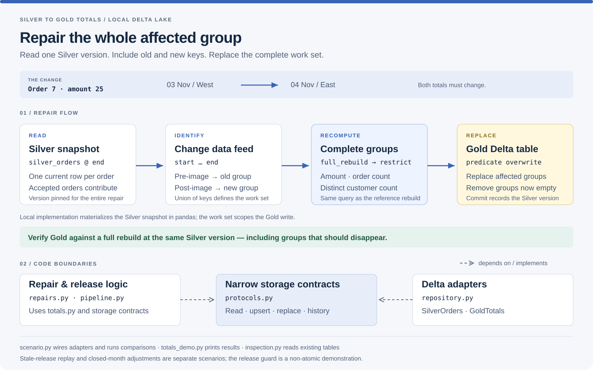
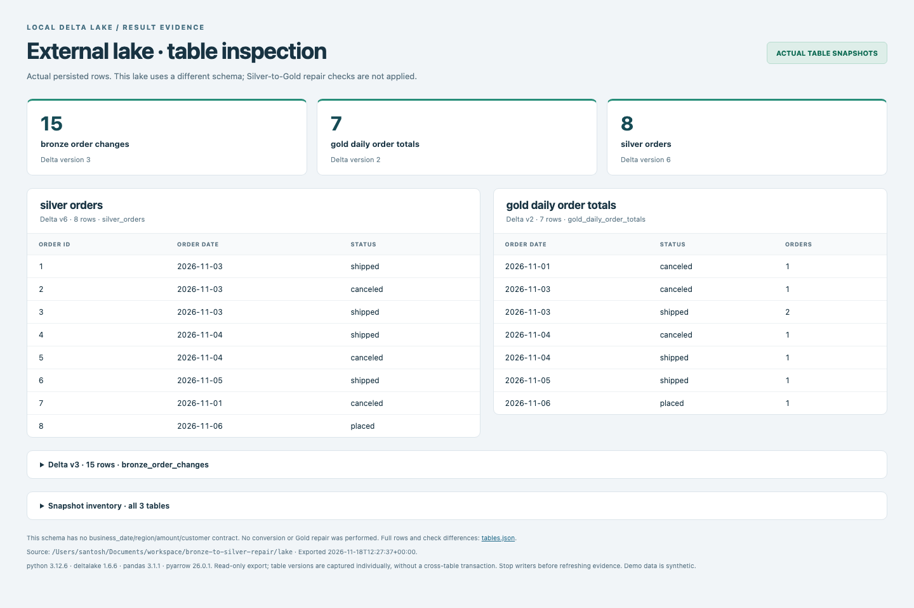

# Silver to Gold Totals

**Repair the Gold aggregates affected by a Silver change, and prove the result against a full rebuild.**

An executable companion to **One Silver Row Changed. Which Gold Totals Must Change?** This project demonstrates why an order moving between dates or regions requires repairing both groups, why an upsert leaves obsolete groups behind, and why distinct customer counts cannot be repaired by simple subtraction.

Built with Python, pandas, PyArrow, and open-source Delta Lake (`deltalake` / delta-rs). Silver and every Gold variant are real Delta tables on local disk. The order data is synthetic; the demo runs without Spark or a Databricks workspace.

## Verified results



*Browser capture of the [generated result report](docs/results/index.html). All displayed values come from Delta snapshot reads. The report distinguishes the repair stage from the later release and closed-month stages.*

The correct replacement strategy matches a full rebuild at **Silver v2**. With the release guard enabled, the newer repair matches **Silver v3** and the stale retry is rejected. The final **Silver v4** totals **365** after the late October correction.

| Evidence | Contents |
| --- | --- |
| [Result screenshot](docs/results/snapshot.png) | Reconciliation outcomes and actual Silver and Gold rows. |
| [HTML report](docs/results/index.html) | Offline report with table versions, inventory, and provenance. Open locally; GitHub displays HTML source. |
| [Table export](docs/results/tables.json) | All persisted table rows, captured versions, reference rebuilds, differences, and runtime versions. |
| [Demo transcript](docs/results/demo-output.txt) | Test results and the complete executable scenario output. |

## Quick start

Requirements: **Python 3.10+**, `pip`, and Bash for the helper script. The initial dependency installation needs access to the Python package index.

```bash
./run_demo.sh
```

The script creates `.venv`, installs dependencies, runs the tests, and prints the scenario results. `deltalake` is pinned to **1.6.6**; other dependencies specify minimum versions.

**Each demo run deletes and recreates this repository's `lake/` directory.** Reserve it for generated demo data. `scenario.run(root)` also recreates its supplied directory; tests use temporary lakes.

Manual execution:

```bash
python3 -m venv .venv
.venv/bin/python -m pip install -r requirements.txt
.venv/bin/python -m pytest
.venv/bin/python -m src.totals_demo
```

## Architecture



The Gold grain is **one row per business date and region**. Only accepted orders contribute:

```sql
SELECT business_date, region,
       SUM(amount) AS net_amount,
       COUNT(*) AS order_count,
       COUNT(DISTINCT customer) AS customers
FROM silver_orders
WHERE status = 'accepted'
GROUP BY business_date, region;
```

[`full_rebuild`](src/totals.py) is the single implementation of that query. Repairs recompute from the Silver snapshot at the requested end version, then select the affected groups. The implementation reads the snapshot into pandas; the work set scopes the Gold write.

A Silver update produces an old row (`update_preimage`) and a new row (`update_postimage`) in the change data feed. The union of their date/region keys defines the work set. [`GoldTotals.replace_groups`](src/repository.py) replaces that scope in one Delta commit and records the input Silver version. A group with no remaining accepted orders is omitted from the replacement and disappears.

[`scenario.py`](src/scenario.py) constructs the adapters and runs the comparisons. Repair strategies and release logic depend on narrow protocols; [`repository.py`](src/repository.py) supplies the Delta implementation. Reporting and read-only inspection are separate modules.

## Scenario walkthrough

Silver starts with **eight accepted orders** and **five Gold groups**. Order **7**, worth **25**, moves from **3 November / West** to **4 November / East**. Its customer still has another order in the old group. Order **8**, the only order in **5 November / South**, is then cancelled.

Each tuple below is **(amount, orders, distinct customers)**.

| Approach | Observed result against Silver v2 |
| --- | --- |
| Recompute new groups, then upsert | The old West group stays at **(125, 3, 2)** instead of **(100, 2, 2)**. The cancelled South group remains. |
| Recompute old and new groups, then upsert | West is corrected, but South remains at **90** because no replacement row exists to upsert. |
| **Recompute old and new groups, then replace** | **Matches the full rebuild.** West becomes **(100, 2, 2)** and South disappears. |
| Add and subtract changed-row contributions | West has **1** distinct customer instead of **2**; South remains as a row of zeros. |

The next stages demonstrate two separate reporting concerns:

- **Stale releases:** order 3 is corrected, reducing West to **95**. Releasing a repair built from Silver v3, then retrying one built from v1, restores the obsolete **100** without the guard. With the guard, the retry is rejected and West stays **95**.
- **Closed periods:** October was approved at **150** and later corrected to **145**. Ignoring the correction leaves the report at **370**. Keeping October approved and booking a **−5** November adjustment yields **365**, matching current Silver.

The Gold variants intentionally remain at different stages:

| Reference | Purpose | Accepted amount |
| --- | --- | ---: |
| Silver v2 | Compare the four repair strategies after the move and cancellation | 375 |
| Silver v3 | Compare guarded and unguarded release replay | 370 |
| Silver v4 | Current truth after the late October correction | 365 |

The closed-period example computes approvals and adjustments in memory. It does not persist an adjustment ledger or update every Gold variant to v4.

## Reproduce the result images

After running the demo, export the existing lake:

```bash
.venv/bin/python -m src.inspection --lake lake --output docs/results
```

Open `docs/results/index.html` in a browser. The exporter reads actual Delta snapshots and writes HTML and JSON outside the source lake. It does not run the scenario or modify its tables. Stop writers while exporting: table versions are captured individually, without a cross-table transaction.

To capture the report as a PNG:

```bash
.venv/bin/python scripts/capture_snapshot.py
```

The screenshot helper uses a locally installed Chrome or Chromium with a temporary profile. Set `CHROME_BIN` if the browser cannot be discovered. A browser is required only for the PNG. Capture dimensions can be set with `--width` and `--height`.

Refresh the committed evidence together:

```bash
mkdir -p docs/results
./run_demo.sh > docs/results/demo-output.txt
.venv/bin/python -m src.inspection --lake lake --output docs/results
.venv/bin/python scripts/capture_snapshot.py
```

The inspector uses **Silver v2** and **v3** as the demo's reference versions. For a changed scenario, supply `--repair-version` and `--race-version` explicitly. If a historical snapshot is unavailable, its checks are marked **UNAVAILABLE**. Invalid current tables cause the export to fail.

### Inspect the bronze-to-silver lake

The related lake at `/Users/santosh/Documents/workspace/bronze-to-silver-repair/lake` was inspected separately. Its captured state contains **15 Bronze events**, **8 Silver orders**, and **7 Gold groups**.

| Contract | This project | Bronze-to-silver project |
| --- | --- | --- |
| Silver columns | `order_id`, `business_date`, `region`, `customer`, `amount`, `status` | `order_id`, `order_date`, `status` |
| Gold grain | Business date and region | Order date and status |
| Measures | Amount, orders, distinct customers | Orders |

The external lake can be viewed with the same read-only exporter:

```bash
.venv/bin/python -m src.inspection \
  --lake /Users/santosh/Documents/workspace/bronze-to-silver-repair/lake \
  --output docs/results/bronze-to-silver

.venv/bin/python scripts/capture_snapshot.py \
  --html docs/results/bronze-to-silver/index.html \
  --output docs/results/bronze-to-silver/snapshot.png --height 960
```



*Separate source lake: [HTML inspection](docs/results/bronze-to-silver/index.html) · [complete table export](docs/results/bronze-to-silver/tables.json). The Silver-to-Gold amount and customer checks do not apply to this schema.*

A direct pipeline connection would require an explicit shared schema and business rules for region, customer, amount, and status eligibility. This inspection performs no conversion. Use the exporter for this path; passing it to `scenario.run` would recreate the directory.

### Read Delta tables correctly

`lake/` is generated and ignored by Git. Each table contains a `_delta_log/` transaction history and Parquet data; Silver also contains change-feed files. Read through Delta so the log selects the live files:

```python
from deltalake import DeltaTable

silver = DeltaTable("lake/silver_orders")
print("Silver version:", silver.version())
print(silver.to_pandas().sort_values("order_id").to_string(index=False))
```

Globbing all Parquet files can include obsolete rows. The small evidence files under `docs/results/` make results reviewable without committing the lake.

## Code structure

Calculations live in `totals.py`, repair strategies in `repairs.py`, and release handling in `pipeline.py`. Storage interfaces are defined in `protocols.py` and implemented by the Delta adapters in `repository.py`. The scenario connects these components; separate modules provide console reporting and table inspection.

The comparison harness invokes each strategy through `GoldRepair`. Three strategies deliberately produce incorrect results; comparison with the full rebuild exposes those failures. [`test_storage_contracts.py`](tests/test_storage_contracts.py) checks the same storage behavior against memory and Delta adapters; [`test_article_claims.py`](tests/test_article_claims.py) checks the scenario outcomes.

The adapters validate update fields and types, escape SQL string literals, reject duplicate Gold keys and replacement rows outside the declared scope, and preserve the Gold schema for empty results.

## Development

```bash
make
```

Runs lint, formatting checks, type checks, tests, and the demo. The demo step recreates `lake/`.

| Command | Purpose |
| --- | --- |
| `make setup` | Install runtime dependencies, pytest, Ruff, and mypy in `.venv`. |
| `make test` | Run calculation, scenario, adapter contract, and inspection tests. |
| `make lint` | Check lint and formatting with Ruff. |
| `make types` | Type-check `src` with mypy. |
| `make demo` | Recreate the demo lake and print results. |
| `make report` | Export the existing lake to HTML and JSON. |
| `make snapshot` | Export the existing lake and capture the report with Chrome/Chromium. |
| `make clean` | Remove `.venv`, `lake/`, tool caches, and bytecode caches. |

All check and demo targets install dependencies first. After setup, tools can be run directly through `.venv/bin/python -m pytest`, `ruff`, or `mypy`.

```text
.
├── data/                       # Synthetic orders and change timeline
├── docs/
│   ├── architecture.svg        # Repair flow and code boundaries
│   └── results/                # Report, JSON, transcript, and screenshots
├── scripts/capture_snapshot.py # Reproducible browser capture
├── src/
│   ├── models.py               # Grain, columns, changes, releases, adjustments
│   ├── protocols.py            # Storage capabilities and strategy contract
│   ├── totals.py               # Gold query and comparison helpers
│   ├── repairs.py              # Four repair strategies
│   ├── pipeline.py             # Release guard and closed-month adjustments
│   ├── repository.py           # Delta persistence adapters
│   ├── scenario.py             # Composition and example orchestration
│   ├── totals_demo.py          # Console report
│   └── inspection.py           # Read-only HTML and JSON export
├── tests/                      # Unit, scenario, contract, and inspection checks
├── Makefile
├── pyproject.toml
├── requirements.txt
└── run_demo.sh
```

## Scope and limitations

- **Local correctness example:** pandas materializes all reads. Eight synthetic orders establish behavior, not production throughput or cost.
- **Non-atomic release guard:** the version check and write are separate operations. Concurrent writers can both pass. Production publication needs atomic coordination or a single writer.
- **Table-wide watermark:** the guard rejects older or equal versions. It assumes each newer release covers all outstanding changes; independently scoped releases need different coordination.
- **Sequential replay:** the stale-release scenario replays releases in sequence; it does not execute concurrent jobs.
- **Closed periods:** approvals and adjustments are calculated in memory. Production reporting needs a persisted, governed adjustment ledger.
- **Reference changes:** the work set comes from orders CDF. Changes in joined reference tables require their own impact analysis.
- **Engine boundary:** local delta-rs predicate overwrite and merge are executed. Databricks materialized views and Databricks SQL commands are outside this project.

All example data is synthetic. See [data/README.md](data/README.md) for fields and the timeline. No `LICENSE` file or reuse license is currently declared.

## Support

[](https://buymeacoffee.com/santoshshin)
